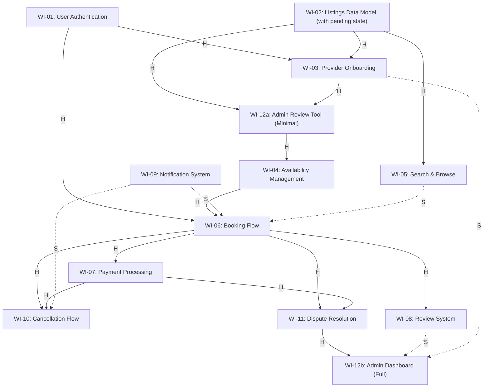

# SkillSwap Dependency Graph (DAG) — Module 02 (Updated with Cycle Fix)

## 1. Work Item Decomposition (13 Work Items after Cycle Fix)

1. **WI-01: User Authentication** — Registration, login, JWT issuance, password reset, and role management (Learner, Provider, Admin).
2. **WI-02: Listings Data Model** — Core schema definitions for provider profiles, categories, service listings, hourly rates, and status (`pending`, `active`, `suspended`).
3. **WI-03: Provider Onboarding** — Provider identity verification, application submission in `pending` state, credential upload.
4. **WI-04: Availability Management** — Recurring time slot definitions, calendar availability, and real-time conflict detection.
5. **WI-05: Search & Browse** — Category navigation, faceted keyword filters, and low-latency cache queries.
6. **WI-06: Booking Flow** — Time slot selection, reservation hold state, learner-provider session association.
7. **WI-07: Payment Processing** — Stripe/escrow hold integration, 15% platform commission deduction, and payout release.
8. **WI-08: Review System** — Post-session learner reviews, star ratings, provider responses, and no-show reporting.
9. **WI-09: Notification System** — Email and push notification delivery for booking confirmations, reminders, and updates.
10. **WI-10: Cancellation Flow** — Cancellation request handler, cooling-off window validation, tier-based refund calculations.
11. **WI-11: Dispute Resolution** — Claim filing for unfulfilled sessions, evidence submission, and refund hold state.
12. **WI-12a: Admin Review Tool (Minimal)** — Lightweight CLI/API endpoint allowing admins to inspect `pending` providers and toggle status to `active` (Breaks the cycle).
13. **WI-12b: Admin Dashboard (Full)** — Complete administrative UI with platform analytics, dispute arbitration, financial summaries, and bulk operations.

---

## 2. Resolving the Circular Dependency (BREAK -> FIX)

### The Cycle Identified:
```text
[Provider Vetting] -> needs [Admin Dashboard] -> needs [Provider Data] -> needs [Provider Vetting]
```

### The Architectural Resolution:
1. **Lifecycle Decoupling:** Provider data is allowed to exist in a `"pending"` state upon registration before vetting is completed.
2. **Node Splitting:** We split `Admin Dashboard` into **WI-12a (Minimal Review Tool)** and **WI-12b (Full Admin Dashboard)**.
   * `WI-12a` is a minimal review mechanism placed on the critical path to unblock provider activation immediately.
   * `WI-12b` (the full dashboard with charts and disputes) is removed from the onboarding critical path and shifted to a parallel track.

---

## 3. Revised Visual Dependency Graph (Mermaid & ASCII)



### ASCII Graph Representation

```text
  [WI-01: Auth]          [WI-02: Listings Model]          [WI-09: Notifications]
     |         \             /       |        \                     :
    (H)         (H)        (H)      (H)       (H)                   : (S)
     |            v       v          |          v                   :
     |       [WI-03: Onboard]        |      [WI-05: Search]         :
     |              |                v              :               :
     |             (H) ----> [WI-12a: Review Tool]  : (S)           :
     |                               |              :               :
     |                              (H)             :               :
     |                               v              v               v
     |                     [WI-04: Availability] -> [WI-06: Booking] <-+
     |                                                     /    |    \
     +----------------------------------------------------+    (H)   (H)
                                                                |     |
                                                                v     v
                  [WI-07: Payment] <---------------------+   [WI-10] [WI-08]
                         |                               |             :
                        (H)                              |             : (S)
                         v                               |             v
                  [WI-11: Disputes] ----------------(H)----> [WI-12b: Full Admin]
```

---

## 4. Revised Critical Path Analysis

### Primary Critical Path:
```text
WI-02 (Listings Model) -> WI-03 (Provider Onboarding) -> WI-12a (Admin Review Tool) -> WI-04 (Availability) -> WI-06 (Booking Flow) -> WI-07 (Payment) -> WI-11 (Disputes) -> WI-12b (Full Admin Dashboard)
```
* **Status:** Fully acyclic. No circular deadlocks remain.
* **Benefit of Split:** Even though the chain depth is 8 nodes, `WI-12a` is a minimal 1-day implementation (e.g. an admin approval CLI/status endpoint), unblocking provider availability and bookings far faster than waiting for the entire full admin dashboard to be built.
